# Highly Available, Self-Healing HTTPS Web App
## Project Overview
This project demonstrates the design and implementation of a highly available, scalable, self-healing web application architecture on AWS. A small web page shows which server and Availability Zone (AZ) served each request. It is deployed across two Availability Zones behind an Application Load Balancer (ALB) with HTTPS, running on an Auto Scaling Group (ASG) of EC2 instances.
The application itself is deliberately simple so that the infrastructure is the focus. The project is proven by deliberately breaking the system (terminating servers, stopping the app, removing an AZ, generating load) and observing that it recovers on its own
## Objectives
The primary objectives of this project are:

1.	High availability: deploy instances across multiple Availability Zones so the loss of one AZ does not take the application offline.
2.	Automatic traffic distribution: use an Application Load Balancer to spread incoming requests across healthy instances.
3.	Self-healing: use ELB health checks with the Auto Scaling Group so failed or unhealthy instances are terminated and replaced automatically.
4.	Scalability: use a target tracking scaling policy so capacity grows and shrinks with demand.
5.	Secure access: serve traffic over HTTPS using an ACM certificate, restrict instance access to the load balancer only, and use Session Manager instead of SSH.
6.	Observability: monitor the system with CloudWatch alarms, a dashboard and SNS email notifications.
## Architecture
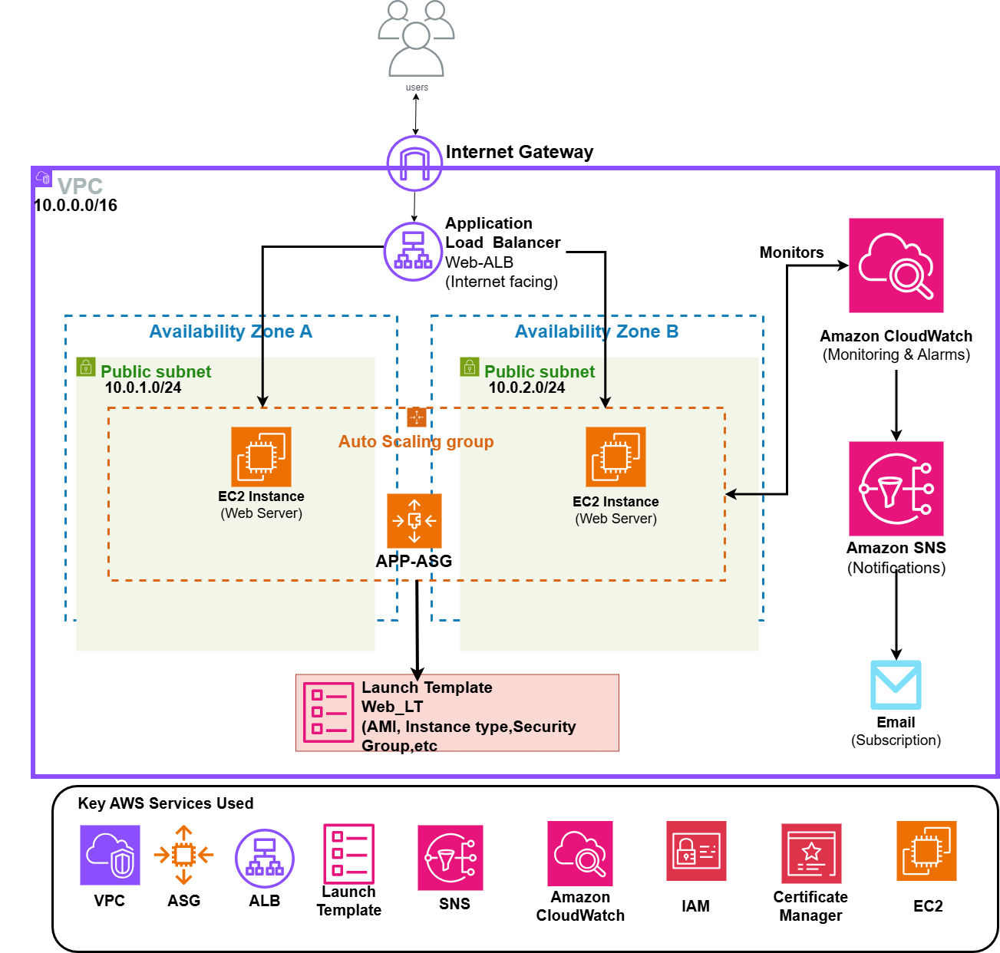
## AWS Services Used
| AWS Service | Purpose |
|---|---|
| Amazon VPC | Virtual Network isolation |
| Internet Gateway | VPC resources to communicate with the internet |
| Amazon EC2 | Web/application servers |
| Application Load Balancer | Traffic distribution and high availability |
| Target Group | Health checking and routing traffic to EC2 |
| Auto Scaling Group | Automatic scaling and instance replacement |
| Launch Template | Standardized EC2 instance configuration |
| Amazon CloudWatch | Monitoring and alarms |
| Amazon SNS | Email notifications |
| Amazon Certificate Management | SSL/TLS certificates to secure websites |
# Phase 1: Networking
A VPC in N. virginia was created for the project
The VPC contains:

1.  Two Availability Zones
2.  Two Public Subnet
3.  Internet Gateway
4.  Route Table

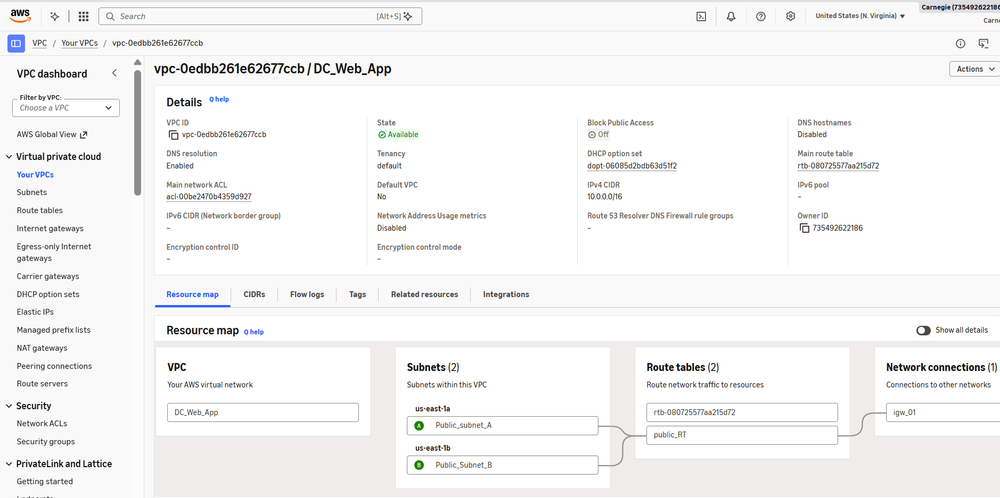

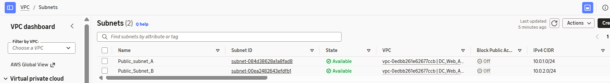

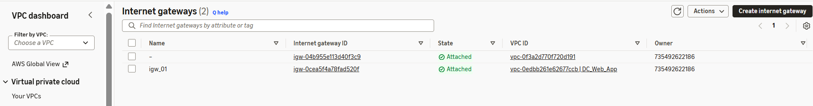

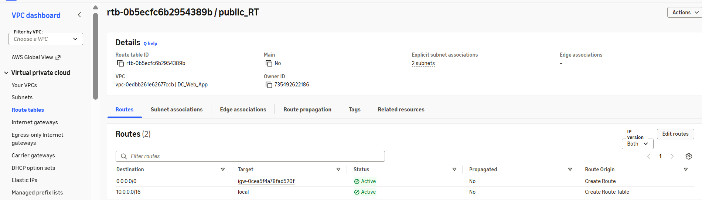

# Phase 2: Security and Access
Two security groups were created.

1. Application load balancer security group
2. webapp security group

| Name | Inbound rules |
| --- | --- |
| alb-sg | HTTP 80 from8 0.0.0.0/0, HTTPS 443 from 0.0.0.0/0 | 
| webapp-sg | HTTP 80, source = alb-sg (select the group, not an IP range |

leave outbound as default. there is no SSH rule because i used session manager

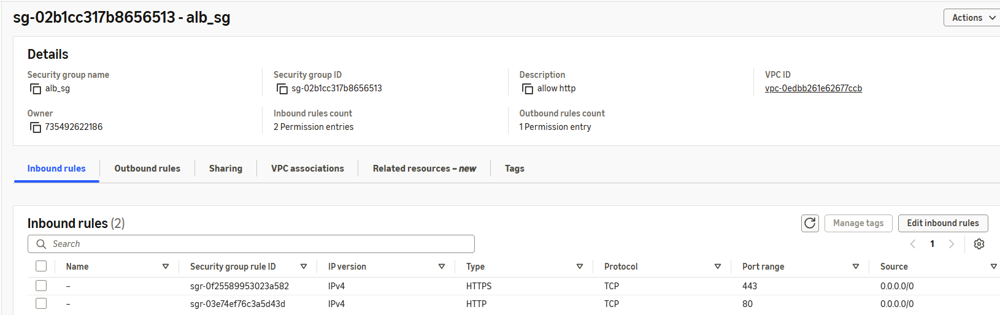

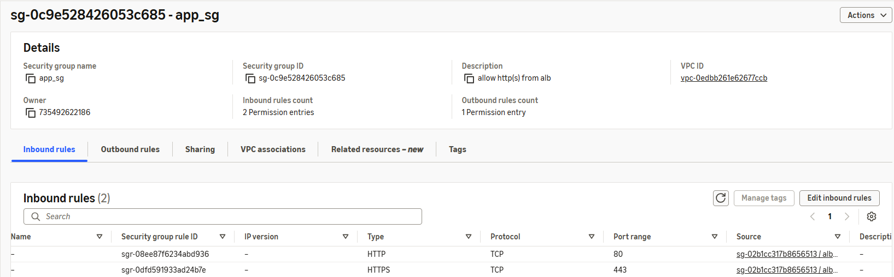

## IAM role
1. IAM role was created
2. attached AmazonSSMManagedInstanceCore

# Phase 3: Compute and Load Balancing
The webserver host a simple web application used to validate
1. Connectivity
2. load balancing
3. health checks
4. failover

The Instances and https application were created using a launch template and user data was also included in the launch template

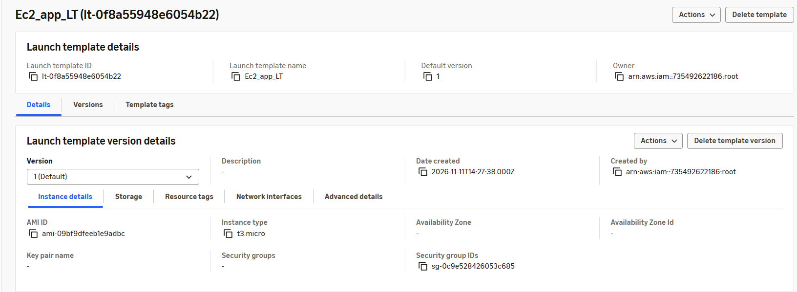

## Target group and Health Check
A target group was created for the web servers.

The target group performs health checks against the EC2 instances.

Only healthy instances receive traffic.

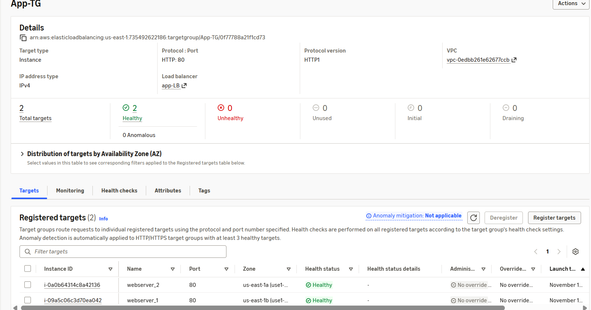

## Application Load Balancer
An internet-facing Application Load Balancer was created.

The ALB receives HTTP requests from users and distributes them across healthy EC2 instances.

Traffic flow:

```text
User
 |
 v
Application Load Balancer
 |
 +----> EC2 Instance AZ-A
 |
 +----> EC2 Instance AZ-B
```
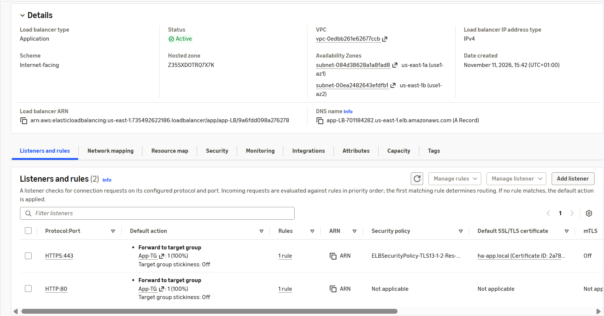

## Application Testing
The application was tested through the Application Load Balancer DNS name.

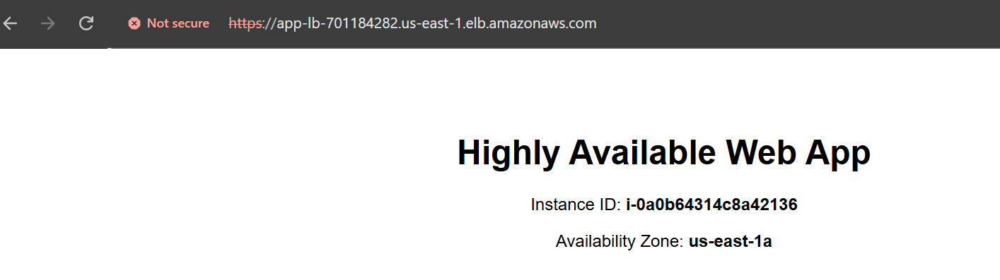


## Auto Scaling Group
An Auto Scaling Group named was configured with

```text
Minimum capacity: 2
Desired capacity: 2
Maximum capacity: 4
```

The instances are distributed across multiple Availability Zones.

The Auto Scaling Group provides:

1.  Automatic instance replacement
2.  Capacity management
3.  Multi-AZ deployment
4.  Self-healing capability
   
## High Availability and Self-Healing Test
A failure simulation was performed by terminating one of the EC2 instances managed by the Auto Scaling Group.

Expected behavior:

```text
EC2 Instance Failure
        |
        v
Auto Scaling Group detects reduced capacity
        |
        v
New EC2 instance launched
        |
        v
Instance becomes healthy
        |
        v
ALB routes traffic to healthy instance
```

The Auto Scaling Group successfully launched a replacement instance.

This demonstrated the self-healing capability of the architecture.

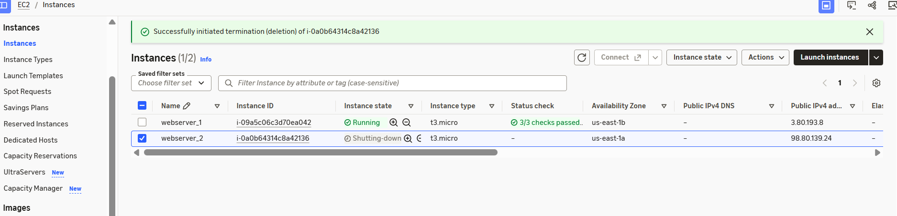

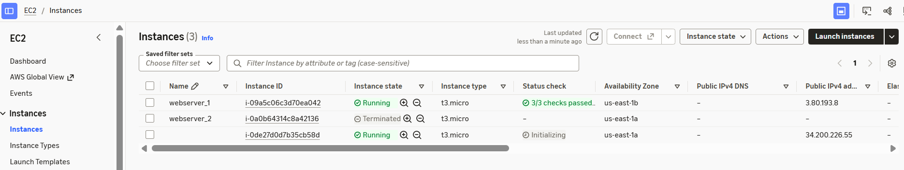

# Phase 4
## HTTPS (Certificate Management)
a self-signed certificate was created to test for a secure website using TLS

Generate the certificate in cloudshell and import into ACM

add HTTPS listener and redirect

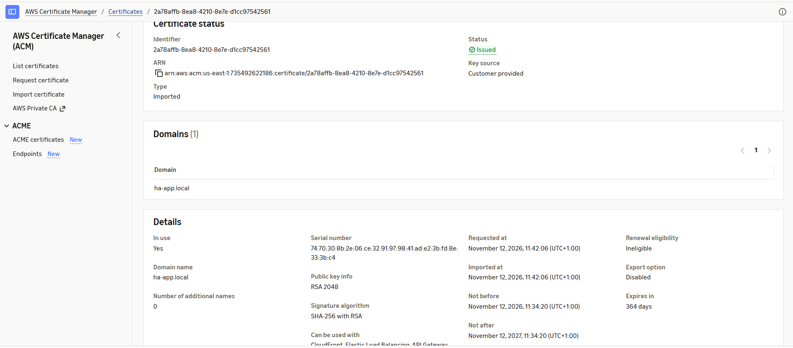

# Phase 5: Monitoring
Amazon CloudWatch was configured to monitor EC2 CPU utilization.

The project uses CPU alarms with a threshold of:

```text
CPU Utilization > 70%
```

for five minutes.

CloudWatch provides visibility into application server resource utilization and can be extended to support automated scaling policies.

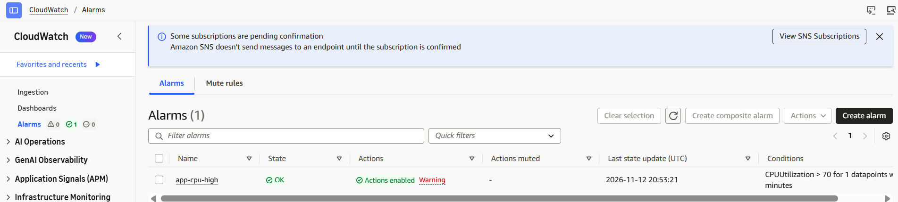

# 12. High Availability Test Results

| Test                              | Expected Result                | Result   |
| --------------------------------- | ------------------------------ | -------- |
| Access application through ALB    | Application loads              | ✅ Passed |
| ALB routes traffic to EC2         | Traffic reaches healthy target | ✅ Passed |
| EC2 instance failure              | ASG replaces instance          | ✅ Passed |
| Replacement instance health check | Instance becomes healthy       | ✅ Passed |
| ALB after instance replacement    | Application remains available  | ✅ Passed |
---
